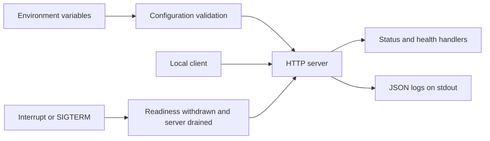

# BeaconForge

<p align="center">
  
</p>

A small Go HTTP service for practising health checks, container packaging, and
graceful shutdown.

[](LICENSE)
[](.github/workflows/ci.yml)
[](.github/workflows/security.yml)

## Purpose

Use BeaconForge as a reference workload when learning how to start, monitor, and
stop a service. It returns JSON from three endpoints, validates its configuration,
and writes request logs to standard output. You can run it directly with Go or
use its container definition without an AWS account.

This is a learning project, not a complete platform or a business API. It has no
database, authentication, TLS, metrics exporter, or Kubernetes deployment. The
repository is not published yet; the badges describe configured workflows, not
successful GitHub runs.

## Architecture



## Quick start

You need Go with automatic toolchain selection enabled. The release is declared
in [go.mod](go.mod); Go may download it on the first run. PowerShell and container
tools are not required for this path.

From the project root:

```sh
go run ./cmd/api
```

Wait for the JSON log message `service started` before making requests. The first
run may take longer while Go downloads its toolchain or compiles dependencies.

In another terminal, check readiness:

```sh
curl http://127.0.0.1:8080/health/ready
```

```json
{"status":"ready"}
```

In Windows PowerShell, use `Invoke-RestMethod
http://127.0.0.1:8080/health/ready` instead of its `curl` alias. Stop the service
with `Ctrl+C`.

## Endpoints

| Request | HTTP status | JSON response |
|---|---|---|
| `GET /api/v1/status` | 200 | `{"status":"ok"}` |
| `GET /health/live` | 200 | `{"status":"alive"}` |
| `GET /health/ready` | 200 when ready, 503 otherwise | `{"status":"ready"}` or `{"status":"not_ready"}` |

Readiness is an in-process flag. It does not check a database or another service.
Shutdown withdraws readiness and stops accepting new connections. Unknown paths
return 404; unsupported methods on these paths return 405.

Request logs contain the method, response status, and duration. They omit paths,
query strings, request headers, and bodies. Responses include `Cache-Control:
no-store` and `X-Content-Type-Options: nosniff`.

## Configuration

| Variable | Default | Allowed values |
|---|---|---|
| `APP_HOST` | `127.0.0.1` | IPv4 or IPv6 address, not a hostname |
| `APP_PORT` | `8080` | Integer from 1024 to 65535 |
| `APP_SHUTDOWN_TIMEOUT` | `10s` | Go duration from 1 second to 1 minute |

Unset values use the defaults. Empty or invalid values fail startup instead of
being ignored. Set a different port if 8080 is already in use:

```powershell
$env:APP_PORT = '18080'
go run ./cmd/api
```

On Linux or macOS, use `APP_PORT=18080 go run ./cmd/api`.

## Container

This path needs a running Docker engine. The [Dockerfile](Dockerfile) builds a
static executable with a digest-pinned Go image. Its `scratch` runtime has no
shell or package manager and runs as UID/GID `65532`.

Build the image, then run it in the foreground:

```sh
docker build --tag beaconforge:local .
docker run --rm --name beaconforge --read-only --cap-drop=ALL --security-opt=no-new-privileges:true --pids-limit=64 --memory=128m --cpus=1 --publish 127.0.0.1:8080:8080 beaconforge:local
```

Check the same endpoints from another terminal. The container listens on all
interfaces internally, but the command publishes its host port on loopback only.
The runtime restrictions above are not automatically enforced by the image.

Stop it from another terminal and remove the local image when finished:

```sh
docker stop --time 15 beaconforge
docker image rm beaconforge:local
```

`--rm` removes the container after it stops. With a longer shutdown timeout,
increase Docker's stop timeout too. Do not run the host service and container on
the same host port.

## Adapting the service

Change listener settings through environment variables, not the entry point.
Configuration lives in [config.go](internal/service/config.go), request handling
in [http.go](internal/service/http.go), and shutdown in
[run.go](internal/service/run.go). The entry point only wires these together.

Use the project as a starting point rather than an importable library. Go's
`internal` package rules prevent another module from importing `internal/service`.
If you copy the project under a new module name, update [go.mod](go.mod) and the
service import in [main.go](cmd/api/main.go). Keep configuration and handler tests
with the code you reuse. The [MIT license](LICENSE) permits reuse with its notice
retained.

## Development

For Windows users, [local.ps1](scripts/local.ps1) provides the commands used by CI:

```powershell
.\scripts\local.ps1 -Action Test
.\scripts\local.ps1 -Action Build
```

`Test` runs `go vet`, tests, and the pinned Go vulnerability scanner. `Build`
writes an executable to `.tmp/`, excluded from Git. The helper selects the project
toolchain and restores the previous toolchain environment afterward.

See [CONTRIBUTING.md](CONTRIBUTING.md) for direct Go commands, review expectations,
and optional Windows tool/chart downloads. These downloads are not required to
run the service and do not deploy a platform.

## Security and limits

Keep the service on loopback. It uses plain HTTP, has no access control, and is
not suitable for public or sensitive workloads without additional controls.
Read/write timeouts and header-size limits are bounded, but they do not make it
resistant to every denial-of-service attack. No application data is persisted.

[CI](.github/workflows/ci.yml) defines Windows/Linux checks and Linux race
detection. The [security workflow](.github/workflows/security.yml) defines
gitleaks, Go CodeQL, dependency review, Trivy, and a container smoke test. Action
versions are pinned by SHA. Trivy and dependency review block HIGH/CRITICAL
findings; CodeQL alerts still require review and merge protection configuration.

The service has been checked locally. Docker execution and GitHub-hosted scans
have not been verified here. No cloud infrastructure is provisioned. Optional
chart packages do not imply that Kubernetes, monitoring, or a database is running.
See [SECURITY.md](SECURITY.md) for reporting and the current boundaries.

## Contributing and license

Follow [CONTRIBUTING.md](CONTRIBUTING.md) and the
[Code of Conduct](CODE_OF_CONDUCT.md). BeaconForge is released under the
[MIT License](LICENSE); third-party tools retain their own licences.